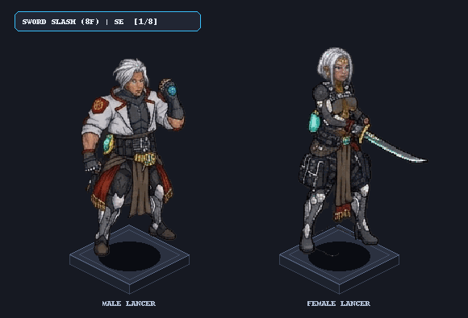
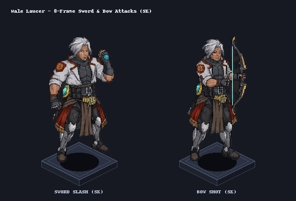
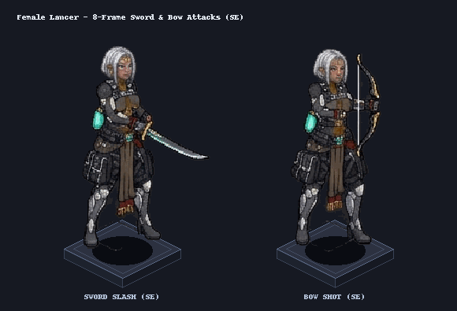
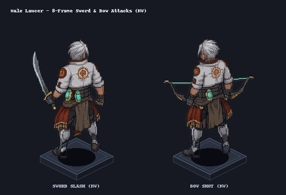
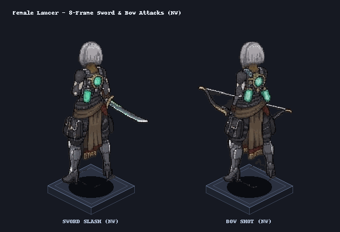
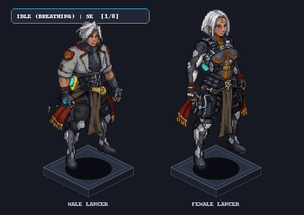
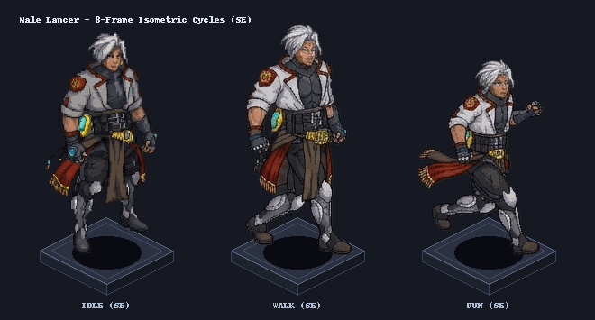
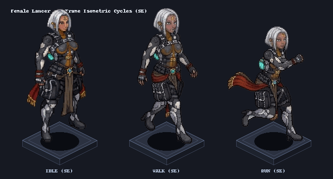
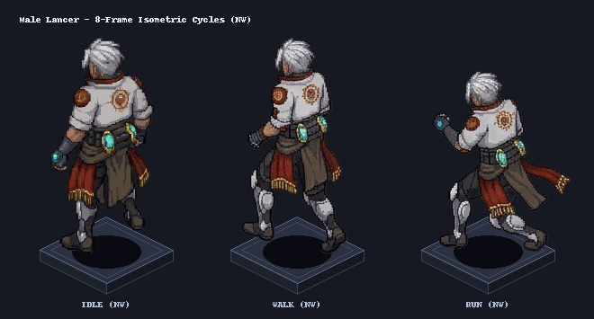
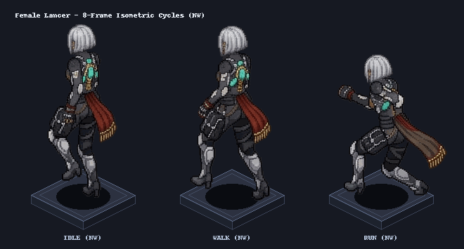

# Soverai — Lancer (The Old Guild / Nômade) 5×8 Isometric Sprites & Combat Pack

Hi-bit isometric pixel art character sprites, **animated GIFs**, and **5×8 master sprite sheets** (**Breathing Idle**, **Walk**, **Run**, **Sword Slash**, and **Bow Shot** across `SE`, `SW`, `NW`, and `NE`) for the Male and Female **Lancers** (*A Velha Guilda*).

## Interactive Browser Previewer

- **GitHub Pages (Live):** https://caio-bress.github.io/soverai-lancer-sprites/
- **Local / Offline:** Open [`index.html`](./index.html) or [`lancer_isometric_previewer.html`](./lancer_isometric_previewer.html) directly in any desktop browser — all 4 transparent 5×8 master sprite sheets are embedded inside the HTML file.

---

## Animated GIF Showcases (`gifs/`)

### Combat Showcase (`Sword Slash` & `Bow Shot` in `SE` & `NW`)

| Male Lancer Combat (`SE` & `NW`) | Female Lancer Combat (`SE` & `NW`) |
| :---: | :---: |
|  |  |
|  |  |

### Movement Showcase (`Idle`, `Walk` & `Run` in `SE` & `NW`)

| Male Lancer Movement (`SE` & `NW`) | Female Lancer Movement (`SE` & `NW`) |
| :---: | :---: |
|  |  |
|  |  |

### Individual Transparent Looping GIFs (`gifs/`)
| Character & Dir | Idle (Breath) | Walk (8f) | Run (8f) | Sword Slash (8f) | Bow Shot (8f) |
| :--- | :--- | :--- | :--- | :--- | :--- |
| **Male — `SE`** | [`idle`](./gifs/male_lancer_se_idle.gif) | [`walk`](./gifs/male_lancer_se_walk.gif) | [`run`](./gifs/male_lancer_se_run.gif) | [`sword`](./gifs/male_lancer_se_sword.gif) | [`bow`](./gifs/male_lancer_se_bow.gif) |
| **Male — `NW`** | [`idle`](./gifs/male_lancer_nw_idle.gif) | [`walk`](./gifs/male_lancer_nw_walk.gif) | [`run`](./gifs/male_lancer_nw_run.gif) | [`sword`](./gifs/male_lancer_nw_sword.gif) | [`bow`](./gifs/male_lancer_nw_bow.gif) |
| **Female — `SE`** | [`idle`](./gifs/female_lancer_se_idle.gif) | [`walk`](./gifs/female_lancer_se_walk.gif) | [`run`](./gifs/female_lancer_se_run.gif) | [`sword`](./gifs/female_lancer_se_sword.gif) | [`bow`](./gifs/female_lancer_se_bow.gif) |
| **Female — `NW`** | [`idle`](./gifs/female_lancer_nw_idle.gif) | [`walk`](./gifs/female_lancer_nw_walk.gif) | [`run`](./gifs/female_lancer_nw_run.gif) | [`sword`](./gifs/female_lancer_nw_sword.gif) | [`bow`](./gifs/female_lancer_nw_bow.gif) |

---

## 5×8 Master Transparent Sprite Sheets (`2048×1700` — `256×340` per cell)

- **Row 0 (8f):** Breathing Idle
- **Row 1 (8f):** Pose-Guided Isometric Walk Cycle
- **Row 2 (8f):** Pose-Guided Isometric Run Cycle
- **Row 3 (8f):** *Vharenn* Sword Slash Attack (with glowing cyan energy smear arc)
- **Row 4 (8f):** *Archeotek* Recurve Bow Shot (nock → full flex draw → cyan arrow release)

| 5×8 Master Sheet | Standalone 2×8 Combat Sheet | Direction |
| :--- | :--- | :--- |
| [`male_lancer_isometric_se_5row_master.png`](./sprites/male_lancer_isometric_se_5row_master.png) | [`male_lancer_isometric_se_8f_sword_bow.png`](./sprites/male_lancer_isometric_se_8f_sword_bow.png) | `SE` (flip for `SW`) |
| [`male_lancer_isometric_nw_5row_master.png`](./sprites/male_lancer_isometric_nw_5row_master.png) | [`male_lancer_isometric_nw_8f_sword_bow.png`](./sprites/male_lancer_isometric_nw_8f_sword_bow.png) | `NW` (flip for `NE`) |
| [`female_lancer_isometric_se_5row_master.png`](./sprites/female_lancer_isometric_se_5row_master.png) | [`female_lancer_isometric_se_8f_sword_bow.png`](./sprites/female_lancer_isometric_se_8f_sword_bow.png) | `SE` (flip for `SW`) |
| [`female_lancer_isometric_nw_5row_master.png`](./sprites/female_lancer_isometric_nw_5row_master.png) | [`female_lancer_isometric_nw_8f_sword_bow.png`](./sprites/female_lancer_isometric_nw_8f_sword_bow.png) | `NW` (flip for `NE`) |
