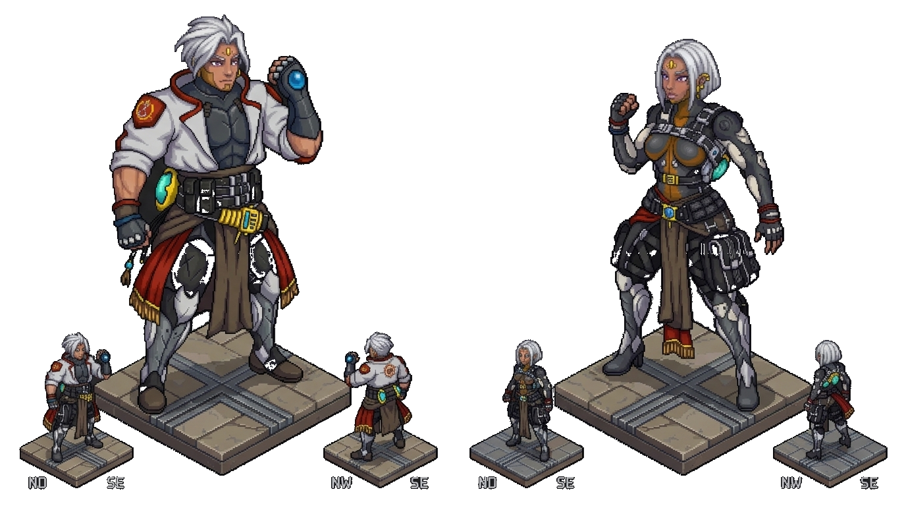

# Soverai — Lancer (The Old Guild / Nômade) Isometric Sprites

Hi-bit isometric pixel art character sprites and animation sheets (**Idle**, **Walk**, and **Running Cycle** across `SE`, `SW`, `NW`, and `NE`) for the Male and Female **Lancers** (*A Velha Guilda*), designed without weapons for modular equipment and *Archeotek* / *Vharenn* effect layering.

## Interactive Browser Previewer

- **Local / Offline:** Open [`lancer_isometric_previewer.html`](./lancer_isometric_previewer.html) (or [`index.html`](./index.html)) directly in any browser — all 4 transparent 3-row sprite sheets are embedded inside the HTML file.
- **GitHub Pages:** `https://caio-bress.github.io/soverai-lancer-sprites/`

---

## Isometric Character Showcase

---

## Transparent Isometric Sprite Sheets (`sprites/`)

### 1. 3-Row Master Sheets (`1344×1080` — Row 0: `Idle`, Row 1: `Walk`, Row 2: `Run`)
- [`sprites/male_lancer_isometric_se_full_sheet.png`](./sprites/male_lancer_isometric_se_full_sheet.png) — Male Lancer (`SE` / flip for `SW`)
- [`sprites/male_lancer_isometric_nw_full_sheet.png`](./sprites/male_lancer_isometric_nw_full_sheet.png) — Male Lancer (`NW` / flip for `NE`)
- [`sprites/female_lancer_isometric_se_full_sheet.png`](./sprites/female_lancer_isometric_se_full_sheet.png) — Female Lancer (`SE` / flip for `SW`)
- [`sprites/female_lancer_isometric_nw_full_sheet.png`](./sprites/female_lancer_isometric_nw_full_sheet.png) — Female Lancer (`NW` / flip for `NE`)

### 2. Running Cycle Sheets (`1344×720` — Row 0: `SE Run`, Row 1: `NW Run`)
- [`sprites/male_lancer_isometric_run_sheet.png`](./sprites/male_lancer_isometric_run_sheet.png)
- [`sprites/female_lancer_isometric_run_sheet.png`](./sprites/female_lancer_isometric_run_sheet.png)

### 3. Idle + Walk Sheets (`1344×720` — Row 0: `Idle`, Row 1: `Walk`)
- [`sprites/male_lancer_isometric_se_sheet.png`](./sprites/male_lancer_isometric_se_sheet.png)
- [`sprites/male_lancer_isometric_nw_sheet.png`](./sprites/male_lancer_isometric_nw_sheet.png)
- [`sprites/female_lancer_isometric_se_sheet.png`](./sprites/female_lancer_isometric_se_sheet.png)
- [`sprites/female_lancer_isometric_nw_sheet.png`](./sprites/female_lancer_isometric_nw_sheet.png)

### 4. Individual Sliced & Stabilized Frames (`224×360` RGBA `.png`)
- `sprites/male_lancer/se/` & `sprites/male_lancer/nw/` (`idle_0..5.png`, `walk_0..5.png`, `run_0..5.png`)
- `sprites/female_lancer/se/` & `sprites/female_lancer/nw/` (`idle_0..5.png`, `walk_0..5.png`, `run_0..5.png`)
